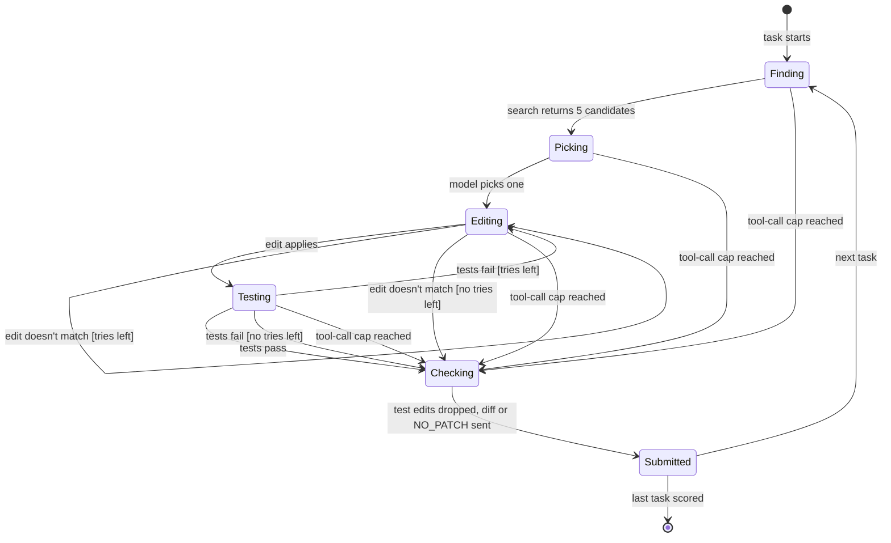

# Ideas run (autonomous, started 2026-11-02)

The one output file for the autonomous "find better ideas" run. Everything done in the run is recorded here.

## Catch-up prompt (paste on the laptop)

> Read agents/IDEAS-RUN.md top to bottom, then agents/PROJECT-BRIEF.md and agents/SESSION-HANDOFF.md. Summarise in plain words what the autonomous run found, which idea it recommends, what was actually tested and what numbers came out, then continue the grilling session from the open questions at the end of IDEAS-RUN.md.

## Context at start of run

- **Project:** Group 9 (Syed Ibad Asim, Areesha Ashfaq). Kaggle "Gemma 4 Developer Agent" main track (Dec 2) plus the Paper Track (Nov 12). Goal: course grade is the floor; win a paper-track prize; stretch goal is the E4B $10k small-model bonus.
- **Hard rules:**
  - Only official competition rules, models and data.
  - The user and partner write all prose.
  - Push only as `vanodew1`, with no Claude attribution in commits.
- **Paper plan before this run:**
  - Question: where does each Gemma size (E2B, E4B, 12B) break as the search-word picker for file localization, and which cheap fixes recover it?
  - Fixes to test: voting, code-name merge, forced JSON, 3-shot.
  - Data: the 129 competition dev tasks.
- **Competition data:** not downloaded yet; it needs the user's Kaggle identity verification and a `kaggle.json` token. Until then, the only runnable data is the 55 old SWE-bench pilot issues. They're for **code checks and early signals only, never paper numbers.**
- **Pilot results on the 55 issues:**
  - Hit@1: 12B 80, E4B 69, E2B 71, rules 69, BM25 58.
  - Hit@3: 12B 93, E4B 85, E2B 80.
- **Machine:** RTX 5070 Ti 16 GB. Ollama models: gemma4:12b, e4b, e2b. WSL2 and Docker are installed.

## Run log

### 1. Sharpen (pstack:sharpen)

- Don't brainstorm cold. First measure where the small models fail, then aim new methods at the biggest failure.
- Raw material: the cached model replies and the per-issue misses.
- Proof that something works: rerunnable scripts, paired tests, and later the leaderboard.
- The final choice of direction stays with the user.

### 2. Failure analysis on the pilot (code-check data, n = 55)

| | Rules | 12B | E4B | E2B | BM25 |
|---|---|---|---|---|---|
| Hit@1 (issues) | 38 | 44 | 38 | 39 | 32 |
| Mean identifiers / paths / error strings per reply | – | 8.8 / 2.3 / 1.3 | 5.4 / 2.7 / 1.1 | 7.3 / 1.3 / 1.2 | – |
| Reply names the gold file among its paths | – | 33 | **35** | 16 | – |

- **Combined ceiling:** at least one method gets Hit@1 on 51/55 issues. The methods make different mistakes.
- **E4B misses (17):** the gold file is still in E4B's top 3 for 9 of them, and in its top 5 for 13.
- **Model disagreement:** 12B-only hits 9, E4B-only hits 3.
- **Main finding:** E4B often *names the right file itself* (35/55, more than 12B), but its other keywords are surface-level API words (`requests.get`, `Session`), so hub files outscore the right one. 12B instead guesses *internal* names it has never seen (`prepare_headers`, `iter_content`), which hit the defining file.
- **So:** small models are weak at *generating* internal names but seem able to *recognise* the right file. That points to methods where the small model **chooses from grounded candidates** instead of guessing search words.

### 3. Swarm brainstorm (pstack:swarm; 4 Opus workers, rank-all)

| Worker | Top idea | Also proposed |
|---|---|---|
| A, selector | **Ground-then-Choose:** the model picks one of the top-5 files, shown as outlines | Hub-challenge duel; yes/no logprob rerank |
| B, competition graphs | Seeded PageRank rerank over the official call graph | Audit of the official graph tools (Best New Resource angle); one-call "symbol cards" skill |
| C, E4B agent | **Pipeline inside a skill:** `locate.py`, then model picks, then one SEARCH/REPLACE edit, `apply.py` tests it, `finish.py` | Test-filtered k-sampling; format LoRA |
| D, wild cards | **"Pick, don't write":** the recognition–generation gap across sizes | Per-stage gold benchmark for the 129 tasks (resource); dev-set memorization; oracle ladder |

**Convergence:** A, C and D independently reached the same core idea: **give small models grounded choices instead of asking them to generate.** B adds a graph signal and C adds the way it ships in the E4B agent.

### 4. Research check (mattpocock-skills:research, background agent)

- **Already published in general form:**
  - arXiv:2410.17820 (on puzzles): models of every size judge equally well, but bigger models generate much better.
  - arXiv:2412.02674: the generation–verification gap grows with model scale.
- **Closest in code:** BLAgent, arXiv:2605.17965. On a weak retriever, LLM reranking gains more than query rewriting (MRR 0.553 → 0.769 vs 0.680), but it only uses models of 32B and up.
- **Not done:** for issue→file localization, nobody compares *the same small model* selecting vs generating, across sizes.
- **Risk:** SweRank (arXiv:2505.07849) found an untrained 8B listwise reranker *hurt* function-level Acc@5.
- **Defensible claim:** "With retrieval fixed, untrained 2–4B models gain more from picking among k outline-rendered candidates than from generating queries, and the advantage shrinks with size." Present it as a measured result, not a new principle.

### 5. Experiment: does choosing beat generating? (`experiments.py`, n = 55 pilot issues, code check only)

- **S1:** the model orders the rules' top-5 files from outlines (class and def names).
- **S2:** the same, but over its own keyword top 5.
- **N:** files the model named itself moved to the front (no extra call; Swarm A's control).
- **P:** memory probe. The model names the file from the issue alone, with no file list and no search.

| Model | Rules K1 | **S1 pick from rules' top 5** | K2 own keywords | N named-first | S2 pick from own top 5 | Gold in S1 pool | P memory | Seconds per pick |
|---|---|---|---|---|---|---|---|---|
| E2B | 69% | **78%** | 71% | 69% | 78% | 98% | 38% | 0.7 |
| E4B | 69% | **80%** | 69% | 67% | 76% | 98% | 64% | 0.4 |
| 12B | 69% | **85%** | 80% | 76% | 78% | 98% | 64% | 1.0 |

Paired exact McNemar tests (issues gained / lost on Hit@1):

| | S1 vs rules | S1 vs own keywords |
|---|---|---|
| E2B | +7 / −2, p = 0.18 | +5 / −1, p = 0.22 |
| E4B | +8 / −2, p = 0.11 | +7 / −1, p = 0.07 |
| 12B | +11 / −2, **p = 0.02** | +7 / −4, p = 0.55 |

**Reading it:**
- Choosing beats generating at **every** size, and the gap is biggest for E4B (+11 points). The named-first control does *not* explain it (it's worse than K2), so the model adds real judgment.
- Choosing from the rules' list beats choosing from its own list. Grounding beats the model's own guesses.
- No generation-overtakes-selection crossover up to 12B; the gap just narrows.
- **Big caveat, the memory probe:** with no file list at all, E4B and 12B name the gold file 64% of the time on requests/flask. These public repos are memorized. The competition's hidden test set uses **private** repos, where memory can't help. So this result has to be re-measured on the competition tasks, and the memory probe must be reported next to it.
- At n = 55 only 12B vs rules is significant. The direction is consistent, the proof isn't there yet.

### 6. Code review and blast radius (pstack:thermo-nuclear-code-quality-review, pstack:blast-radius)

- **Real bug found and fixed:** `parse_order` read the *first* `[` in a reply. E2B often writes "[1]" in its reasoning first, so 25 of 110 E2B picks were parsed from the wrong text. It now reads the last list and counts unparsed replies (0/110 after the fix). The numbers above are after the fix.
- **Also fixed:** the gold-in-pool ceiling is now printed, and the issue count is no longer hard-coded.
- **Left for later (structural):**
  - experiments.py repeats the run.py harness (its own client, cache, hit counter and table); fold the experiments into `run_methods`
  - one `ollama_chat` function plus one `JsonCache`
  - a model column instead of parsing method names
  - `size_label` can collide across model families
- **Blast radius of the run.py change:**
  - the old CLI paths still work (no flag gives no K2 rows; `--gemma` alone reproduces 12B's 80%)
  - only the method label text changed; `demo-notes/index.html` holds a static copy and isn't affected

### 7. Formal verification (pstack:create-formal-verification-skill, pstack:statechart)

**Metric code, with CrossHair** (symbolic execution on the real Python):
- Contracts in `verification/metric_contracts.py`:
  - selector order parsing and the named-first rerank are always permutations
  - Hit@k matches its definition and never drops as k grows
  - Recall@k is in [0, 1]
- **Proven able to fail:**
  - removing the parse fallback gives `parse_order('', 1)`
  - `ranked[:k+1]` gives `hit_at_k(['', ''], [''], 0)`
- Restored code passes. The project skill `.claude/skills/metric-contracts/SKILL.md` holds the run command, coverage, bounds and sync commit bbbd842.

**Planned E4B pipeline, with TLA+/TLC** (`verification/pipeline/`):
- Rules: per-task tool-call cap, 12 h global budget, at most 3 tries, test-file edits never submitted, every task submitted.
- With cap × tasks = budget: 494 states, all rules hold.
- **Design finding:** if per-task cap × tasks exceeds the global budget, TLC finds the shortest failure. Each of 3 tasks goes find → pick → edit → tests fail → edit → tests pass (6 calls), and the third task's last call pushes the total past the budget. On Kaggle, going over 12 h **scores the whole submission zero**. Rule for the real agent: `max_tool_calls × seconds per call × ~120 tasks` must stay below about 11 h, and the cap must be enforced in code, not in the prompt.
- Removing the "drop test-file edits" step breaks `NoTestEditsSubmitted`, so finish.py must strip test edits.
- **Tool note:** the statechart chart step needs `/bin/sh` and failed on Windows. TLC was run directly (Java 21 and tla2tools 1.7.4 in `D:\tools`), and the chart below is hand-drawn from the model.

